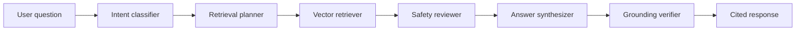

# Healthcare Agentic RAG Workflow

A production-minded starter project for a healthcare domain agentic RAG workflow. It demonstrates how to route clinical questions through planning, retrieval, safety checks, answer synthesis, and verification before returning a cited response.

This is a reference implementation for education and workflow prototyping. It is not a medical device and must not be used as a substitute for clinician judgment.

## What It Does

- Ingests local healthcare guideline documents from `data/sample_guidelines`
- Builds an in-memory TF-IDF vector index
- Runs an agentic workflow:
  - classify the clinical intent
  - plan the retrieval strategy
  - retrieve relevant passages
  - check for safety-sensitive content
  - synthesize an evidence-grounded response
  - verify whether the final answer is sufficiently cited
- Exposes a FastAPI service at `/ask` and `/health`
- Includes tests for retrieval, guardrails, and workflow behavior

## Architecture



## Quick Start

```powershell
python -m venv .venv
.venv\Scripts\Activate.ps1
pip install -e ".[dev]"
python -m healthcare_agentic_rag.cli "What follow-up is recommended for hypertension?"
```

Run the API:

```powershell
uvicorn healthcare_agentic_rag.api:app --reload
```

Example request:

```powershell
Invoke-RestMethod -Method Post http://127.0.0.1:8000/ask `
  -ContentType "application/json" `
  -Body '{"question":"What should a patient with diabetes monitor regularly?"}'
```

## Project Layout

```text
healthcare-agentic-rag/
  data/sample_guidelines/      Sample healthcare knowledge base
  examples/                    Example request payloads
  src/healthcare_agentic_rag/  Application package
  tests/                       Pytest suite
```

## Configure Your Own Knowledge Base

Add `.txt` or `.md` files to a directory and point `RAG_KNOWLEDGE_DIR` at it:

```powershell
$env:RAG_KNOWLEDGE_DIR="C:\path\to\clinical-docs"
uvicorn healthcare_agentic_rag.api:app --reload
```

## Safety Notes

The workflow intentionally adds a medical disclaimer and escalates emergency or high-risk requests. In real deployments, add:

- source governance and document approval
- PHI redaction and audit logging
- clinician review for high-impact use cases
- model monitoring and evaluation datasets
- HIPAA-aligned infrastructure controls where applicable

## Tests

```powershell
pytest
```

